# Sensor Fusion: EKF for Wheel Odometry and IMU

A ROS2 / C++ Extended Kalman Filter that fuses wheel odometry and IMU data for a ground robot, using a constant-acceleration motion model. The project covers the filter design (state, prediction and update), four variants of the filter (one propagated by the IMU), an evaluation on a real outdoor dataset with GPS as ground truth, and a consistency check of each filter with NEES and NIS.

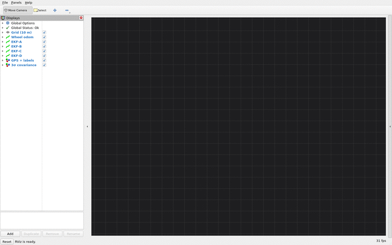

*RViz2 playback of the Linkou dataset at 4x speed. All four filter variants run in parallel and are aligned to GPS (white dots). EKF-C (yellow) follows the GPS track and its 3σ ellipses grow as position is dead-reckoned. EKF-D (pink), which propagates with the IMU and measures only odom velocity, stays close to the track; its ellipses stretch sideways as gyro-only heading uncertainty builds up. EKF-A (orange) and EKF-B (green) drift together with the raw wheel odometry (gray) while reporting less than 1 m of uncertainty.*

### Highlights

- 8-state EKF (position, heading, velocity, yaw rate, acceleration) with pluggable motion and observation models
- Four filter variants compared on a 240 s, 247 m outdoor drive, including an IMU-propagated filter (EKF-D)
- Best variant cuts position error from 19.6 m (wheel odometry) to 1.7 m and heading error from 36° to 1.2°
- Filter consistency checked with NEES (vs GPS) and NIS for every variant
- RViz2 view with live paths and 3σ covariance ellipses, runnable through Docker (`eval/rviz_variants.sh`)

---

## Table of Contents

1. [Overview](#overview)
2. [State Definition](#state-definition)
3. [Process (Motion) Model](#process-motion-model)
4. [Control Input](#control-input)
5. [Prediction Step](#prediction-step)
6. [Update Step](#update-step)
7. [Installation and Usage](#installation-and-usage)
8. [Results on the Linkou Dataset](#results-on-the-linkou-dataset)
9. [Filter Consistency: NEES and NIS](#filter-consistency-nees-and-nis)
10. [Future Scope](#future-scope)
11. [License](#license)

---

## Overview

The Extended Kalman Filter (EKF) is a variant of the Kalman Filter used for **nonlinear** systems. It linearizes the nonlinear process and/or measurement functions about the current estimate using **Jacobian** matrices. The steps are:

1. **Predict** the state based on the motion model and control input (if any).  
2. **Update** the state with incoming sensor measurements.

We apply the EKF in an **8-dimensional** state space to track:
- Position (`x`, `y`)
- Orientation (`theta`)
- Velocity (`v_x`, `v_y`)
- Angular velocity (`omega`)
- Acceleration (`a_x`, `a_y`)

## Features

- Implements **nonlinear motion models** such as constant acceleration.
- Supports **sensor observation models**, including IMU and odometry fusion.
- Modular **EKF framework** with customizable process and observation models.
- **ROS2-compatible** for real-time robotic state estimation.
- **Configurable process noise and sensor noise covariance matrices.**


```
src/
│── motion_model/                   # Motion model implementations
│   ├── include/motion_model/       # Motion model headers
│   ├── src/                        # Source files for motion models
│   ├── CMakeLists.txt              # CMake configuration for motion models
│   ├── package.xml                 # ROS2 package definition
│
│── observation_model/               # Observation model implementations
│   ├── include/observation_model/  # Observation model headers
│   ├── src/                        # Source files for observation models
│   ├── CMakeLists.txt              # CMake configuration for observation models
│   ├── package.xml                 # ROS2 package definition
│
│── kalman_filter_core/              # EKF implementation
│   ├── include/kalman_filter_core/ # EKF headers
│   ├── src/                        # Source files for EKF
│   ├── CMakeLists.txt              # CMake configuration for EKF
│   ├── package.xml                 # ROS2 package definition
│
│── kalman_filter_app/               # Main application
│   ├── src/                        # Main application source files
│   ├── CMakeLists.txt              # CMake configuration for application
│   ├── package.xml                 # ROS2 package definition
│
│── common_utils/                    # Utility functions (e.g., coordinate conversion)
│   ├── include/common_utils/       # Utility headers
│   ├── src/                        # Source files for utilities
│   ├── CMakeLists.txt              # CMake configuration for utilities
│
```

---


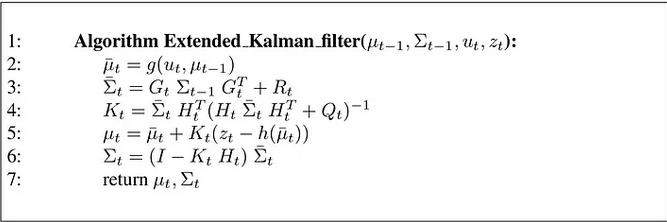


## State Definition

We define the system state as the vector:

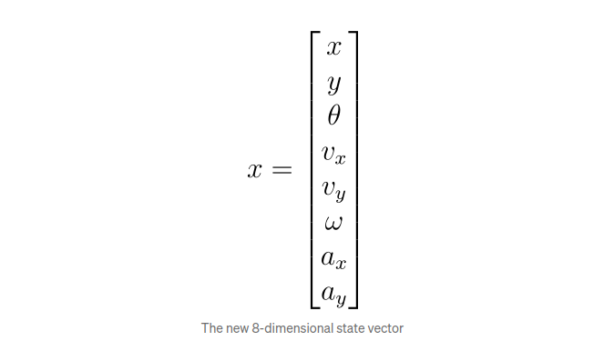
where:

- \(x, y\) : Position in the plane  
- \(\theta\) : Orientation (heading angle)  
- \(v_x, v_y\) : Linear velocities in the \(x\) and \(y\) directions  
- \(\omega\) : Angular velocity (turn rate)  
- \(a_x, a_y\) : Linear accelerations in the \(x\) and \(y\) directions  

The state covariance is an \(8 \times 8\) matrix \(\Sigma\).  

---

## Process (Motion) Model

We assume a **constant acceleration** motion model over a time step \(\Delta_t\). The **nonlinear** function \(g\) predicts the next state \(x_{t}\) from \(x_{t-1}\) and control input \(u_t\):

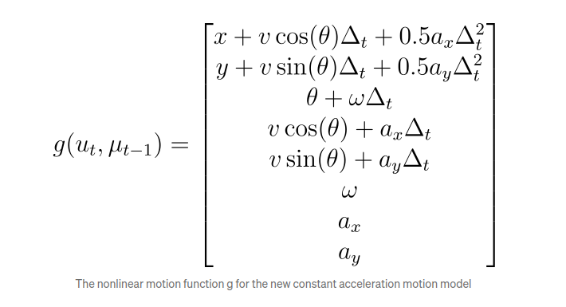

where \(v = \sqrt{v_x^2 + v_y^2}\). 

### Jacobian \(G_t\)
Because \(g\) is nonlinear, the EKF uses the Jacobian:

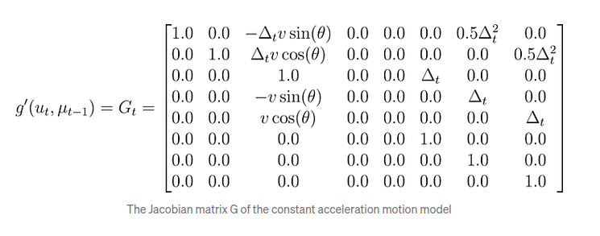

to linearize the process model at the current state estimate.

---

## Control Input

No Control Input was considered in this application 

---

## Prediction Step

1. **Predict State Mean**  
   \[
   \bar{\mu}_t = g\bigl(u_t,\mu_{t-1}\bigr)
   \]

2. **Predict State Covariance**  
   \[
   \bar{\Sigma}_t = G_t \,\Sigma_{t-1}\,G_t^T + R_t
   \]
   - \(G_t\) is the Jacobian of \(g\) evaluated at \(\mu_{t-1}\).  
   - \(R_t\) is the process noise covariance.

---

## Update Step

Upon receiving a measurement (z_t), the EKF incorporates the sensor reading:

1. **Measurement Prediction**:  
   \[
   \hat{z}_t = h(\bar{\mu}_t)
   \]  
   where \(h\) is the measurement function (could be linear or nonlinear).

2. **Jacobian \(H_t\)**:  
   \[
   H_t = \frac{\partial h}{\partial x}\Big|_{\bar{\mu}_t}
   \]

3. **Kalman Gain**:  
   \[
   K_t = \bar{\Sigma}_t\,H_t^T \Bigl(H_t\,\bar{\Sigma}_t\,H_t^T + Q_t\Bigr)^{-1}
   \]

4. **Update Mean**:  
   \[
   \mu_t = \bar{\mu}_t + K_t\bigl(z_t - \hat{z}_t\bigr)
   \]

5. **Update Covariance**:  
   \[
   \Sigma_t = \bigl(I - K_t\,H_t\bigr)\,\bar{\Sigma}_t
   \]

- (Q_t) is the measurement noise covariance.  
- (z_t) is the actual measurement vector at time (t).


## Installation and Usage


## Dependencies

To use this project, ensure the following dependencies are installed:

- **ROS2 (Humble/Foxy recommended)**
- **Eigen3** for matrix operations
- **C++17 or higher**
- **CMake** (minimum version 3.5)
- **Colcon** (for ROS2 package builds)

## Installation & Build

### **1. Clone the Repository**

```bash

git clone https://github.com/mahajanparth/SensorFusion --recursive
cd SensorFusion

```

### **2. Install Dependencies**

```bash
sudo apt update && sudo apt install -y ros-foxy-eigen3 ros-foxy-colcon
```

### **3. Build the Project**

```bash
colcon build --symlink-install
```

### **4. Source the Workspace**

```bash
source install/setup.bash
```

## Run Procedure

### **1. Launch the Full Sensor Fusion Pipeline**

```bash
# variant:=A|B|C|D (default C), inputs default to /wheel_odom and /imu/data_raw
ros2 launch kalman_filter_app launch_ekf_node.py variant:=C

ros2 bag play <bag_dir> --topics /wheel_odom /imu/data_raw
```

The fused estimate is published on `/ekf/odom` (`nav_msgs/Odometry`) and the NIS of every update on `/ekf/nis` (`[stamp, NIS, dim_z]`). To reproduce the results below, see [eval/README.md](eval/README.md).

---

## Results on the Linkou Dataset

The filter was tested on the Linkou bag (download link below), a 240 s, 247 m outdoor drive recorded with wheel odometry (`/wheel_odom`) and an IMU (`/imu/data_raw`).

- Ground truth is the GPS `/fix` topic. It is a standard fix, not RTK, with σ between 0.3 and 5 m, so errors below about 1.5 m are within GPS noise.
- Every trajectory is aligned to GPS with an SE(2) Umeyama fit (rotation and translation, no scale) before computing the error.
- Heading error is measured against the `/odom` reference recorded in the bag.

### Filter variants

All four variants share the EKF core and an 8-state vector. A, B and C use `[x, y, θ, vx, vy, ω, ax, ay]` and treat the IMU as a sensor. D uses `[x, y, θ, vx, vy, b_ω, b_af, b_al]` and treats the IMU as the control input that drives the prediction.

| | EKF-A | EKF-B | EKF-C | EKF-D |
|---|---|---|---|---|
| Motion model | speed √(vx²+vy²) along θ | world-frame constant acceleration | world-frame constant acceleration | IMU-driven: integrates gyro and accelerometer |
| Prediction rate | odom | odom | odom | IMU |
| Jacobian evaluated at | predicted mean | previous posterior | previous posterior | previous posterior |
| Measurements | odom x, y, θ; IMU θ, ω, ax, ay | odom x, y, θ; IMU θ, ω; odom v_fwd, v_lat; IMU ax, ay | IMU θ, ω; odom v_fwd, v_lat; IMU ax, ay | odom v_fwd, v_lat only |
| Fuses odom pose | yes | yes | no | no |
| Uses IMU orientation (yaw) | yes | yes | yes | no (only roll/pitch, to remove gravity) |
| IMU acceleration | raw (gravity tilt included) | gravity removed, body frame | gravity removed, body frame | gravity removed, control input |
| Process noise Q | constant per step | constant per step | constant per step | from IMU noise densities, scales with dt |

Select a variant with `variant:=A`, `B`, `C` or `D` at launch. C is the default.

### Summary

| Method | Position error vs GPS (ATE) | Heading RMSE | Drift per 10 m (RPE) |
|---|---:|---:|---:|
| Raw wheel odometry | 19.58 m | 36.1° | 0.60 m |
| EKF-A | 19.57 m | 18.0° | 4.49 m |
| EKF-B | 19.30 m | 3.5° | 10.19 m |
| **EKF-C** | **1.71 m** | **1.2°** | **0.27 m** |
| EKF-D | 4.14 m | 7.2° | 0.48 m |

Results for four 60 s segments are in [eval/results/metrics.md](eval/results/metrics.md). EKF-C has the lowest drift in every segment and the lowest or tied-lowest position error in all but one (in segment 2, D is at 0.38 m vs 0.46 m).

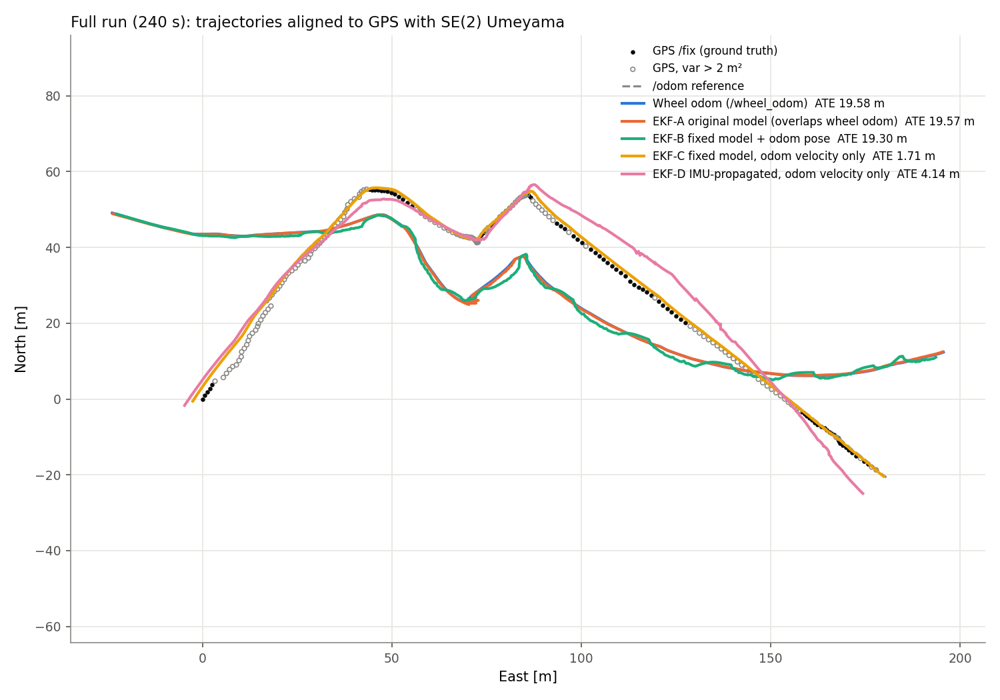

On this dataset the wheel odometry heading drifts by about 130° over the run (its yaw rate reads roughly 20% high), while the IMU heading stays within 2° of the reference. How each variant handles that disagreement explains most of the difference in results.

### EKF-A: original model

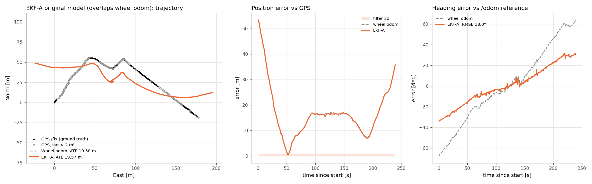

**Model.** The simplest complete IMU and odometry EKF. Every sensor goes into one measurement vector and the observation model is linear (H is a selection matrix), which makes it easy to follow and debug. The constant-acceleration model handles smooth speed changes better than a constant-velocity model.

**Result.** EKF-A lies almost on top of the wheel odometry (19.57 m vs 19.58 m).
- The odometry x and y get the same weight as every other measurement (R = 0.05), so the position follows the drifting wheel path.
- The heading ends up between the wheel and IMU headings. That halves the heading error (18° vs 36°) without removing it.
- Raw accelerometer readings, with gravity leaking in through tilt, are compared directly against world-frame accelerations. This adds jitter and raises the drift per 10 m.
- The 3σ band stays under 1 m while the real error is around 20 m, so the covariance is overconfident.

### EKF-B: corrected model with odom pose

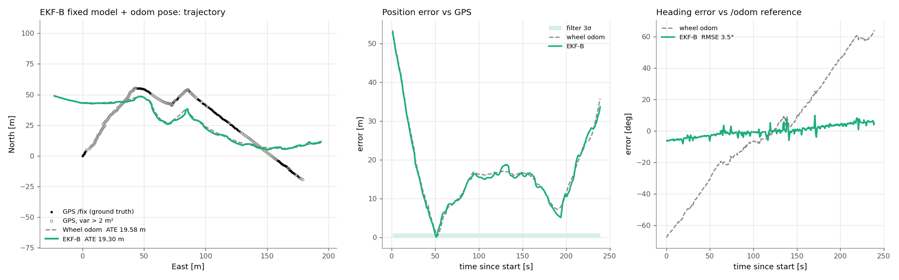

**Model.**
- World-frame constant acceleration keeps the sign of the velocity, so reversing can be represented, and the Jacobian is exact.
- The Jacobian is evaluated at the previous estimate, as in the standard EKF.
- Gravity is removed from the accelerometer using the IMU orientation. Accelerations and wheel velocities are compared in the body frame, where those sensors measure.
- The odom pose is taken relative to the starting pose, so it shares a reference with the IMU yaw. This replaces the hardcoded -90° rotation.

**Result.**
- Heading improves to 3.5° RMSE and no longer drifts (right panel).
- Position does not improve. The odom x and y were integrated with the drifting wheel heading, so they are not independent information, and fusing them keeps pulling the estimate back onto the wheel path (19.30 m).
- The good heading and the biased position conflict, which causes jumps (10.2 m of drift per 10 m travelled) and a 3σ band that is again too small.

### EKF-C: corrected model, wheel velocity and IMU only

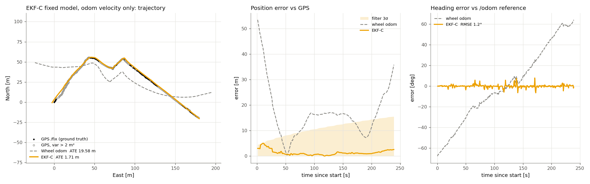

**Model.** Same motion model as B, but it fuses only what each sensor measures well:
- wheels: forward speed, plus lateral speed close to zero for a non-holonomic robot
- IMU: heading, yaw rate and gravity-compensated acceleration

Position is never measured directly. It comes from integrating the wheel speed along the IMU-corrected heading, which treats wheel odometry as a velocity sensor rather than a pose sensor.

**Result.**
- The trajectory stays on the GPS track for the whole drive (1.71 m vs 19.58 m for wheel odometry). Most of the remaining error is in the first 30 s, where the GPS fix is weakest (open circles).
- Heading error stays flat around 0° (1.2° RMSE).
- The 3σ band grows steadily as position is dead-reckoned and always contains the actual error, so the reported covariance is reliable.

### EKF-D: IMU-propagated, odom velocity as the only measurement

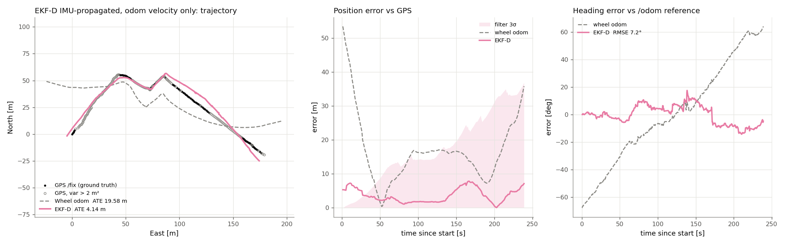

**Model.** The IMU is no longer a measurement. On every IMU message the filter integrates the bias-corrected gyro rate and gravity-compensated acceleration (rotated into the world frame by θ) to predict position, heading and velocity. On every wheel-odom message it corrects with the body-frame velocity `[v_fwd, v_lat]` and nothing else: no odom pose, no odom yaw rate, no IMU yaw.
- The state carries a gyro bias and two accelerometer biases instead of ω, ax and ay.
- Process noise comes from the IMU noise densities mapped through the input Jacobian, plus a small random walk, so Q scales with dt rather than with the number of messages.
- Between two IMU samples the input is their mean (trapezoidal rule).

**Result.**
- 4.14 m position error and 7.2° heading RMSE, against 19.6 m and 36° for wheel odometry. On its own the odom velocity becomes a useful measurement once the heading comes from the gyro.
- It does not reach C. With only velocity measured, heading and position are unobservable, so D's heading is pure gyro dead-reckoning. The IMU in this bag arrives at about 4.7 Hz in bursts, with gaps of up to 0.8 s, and integrating it alone already gives up to 12° of heading error. C instead corrects heading every step with the IMU's own orientation estimate, which stays within 2° of the reference.
- Estimating the gyro bias from velocity residuals made heading worse (13° RMSE). At this IMU rate the residuals mostly come from accelerometer error, so the bias prior is kept tight (σ ≈ 0.002 rad/s, from the standstill samples).
- D is the only variant whose position covariance matches its error (NEES inside the χ² bound, below). The 3σ band grows with distance and contains the error for the whole run.

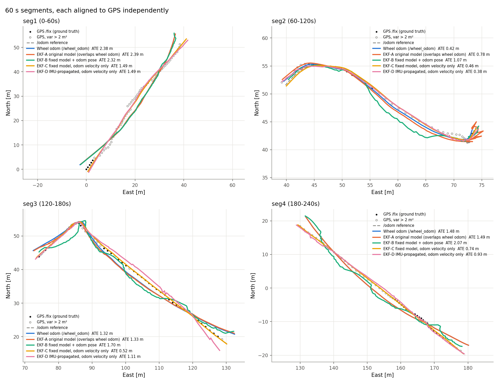

---

## Filter Consistency: NEES and NIS

A filter is consistent when its covariance matches its actual error. Two standard checks, computed by [eval/evaluate.py](eval/evaluate.py) for every variant:

- **NIS** (normalized innovation squared) `νᵀ S⁻¹ ν`, from the filter's own innovation ν and innovation covariance S at each update. It needs no ground truth. For a consistent filter it follows χ² with `dim_z` degrees of freedom.
- **NEES** (normalized estimation error squared) `eᵀ P⁻¹ e`, using ground truth. Position NEES (2 dof) uses GPS. The estimate is aligned with the same SE(2) fit as the ATE, its covariance is rotated with it, and the GPS variance is added to P because the ground truth is itself noisy. Heading NEES (1 dof) uses the `/odom` reference, which has no covariance of its own, so it is an upper bound.

A mean above the 95% χ² bound means the filter is **overconfident** (its covariance is too small). A mean below it means it is **underconfident**.

Thresholds (two-sided 95%, i.e. the 2.5% and 97.5% points of χ²):

| dof | Used for | Per-sample region | Bound on the mean (N samples) |
|---:|---|---:|---:|
| 1 | heading NEES | 0.001 – 5.02 | 0.92 – 1.09 (N ≈ 1090) |
| 2 | position NEES | 0.051 – 7.38 | 1.75 – 2.26 (N ≈ 240 GPS fixes) |
| 2 | NIS, EKF-D | 0.051 – 7.38 | 1.88 – 2.12 (N = 1089) |
| 6 | NIS, EKF-C | 1.24 – 14.45 | 5.80 – 6.21 (N = 1088) |
| 7 | NIS, EKF-A | 1.69 – 16.01 | 6.78 – 7.22 (N = 1088) |
| 9 | NIS, EKF-B | 2.70 – 19.02 | 8.75 – 9.25 (N = 1088) |

The per-sample region should contain about 95% of the individual values. The bound on the mean is `χ²(N·dof)/N` at the same probabilities, and it decides "over" or "under" in the table below. It assumes independent samples. Consecutive NEES/NIS values are correlated, so the true band is wider, and values just outside it (such as D's heading NEES of 1.15) are borderline rather than clear failures.

| Variant | NIS mean (expected) | Position NEES mean (expected 2) | Heading NEES mean (expected 1) |
|---|---:|---:|---:|
| EKF-A | 34.4 (7), over | 407, over | 4.8, over |
| EKF-B | 173 (9), over | 361, over | 12.3, over |
| EKF-C | 0.92 (6), under | 0.30, under | 1.4, over |
| EKF-D | 0.23 (2), under | **2.2, consistent** | 1.15, slightly over |

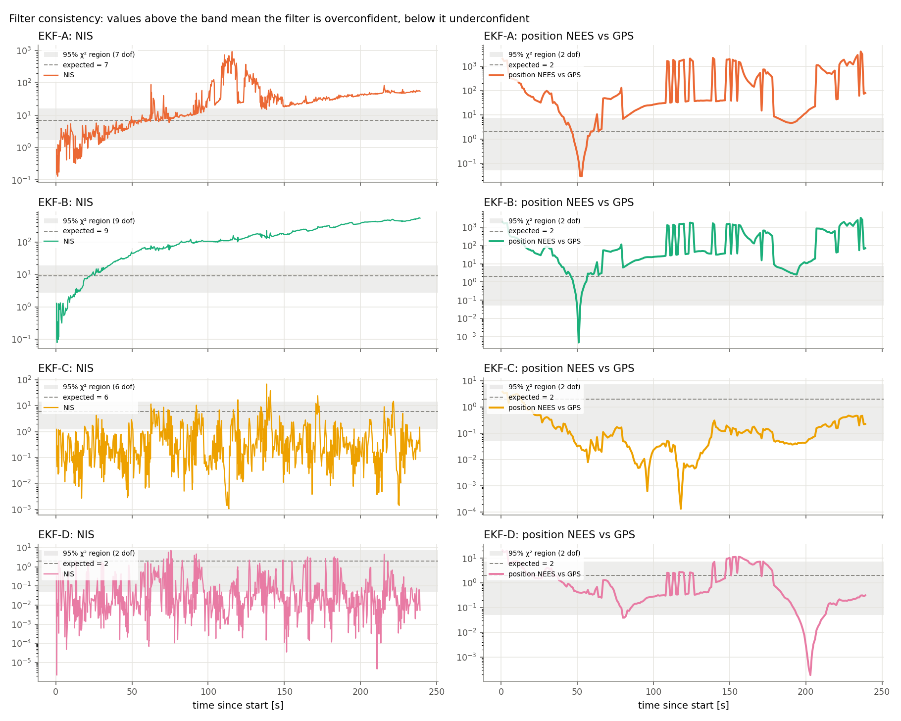

- **A and B are badly overconfident.** Their NIS rises during the run because the odom pose and the IMU heading disagree more and more, and the filter has no way to explain that. Position NEES in the hundreds matches the 20 m error against less than 1 m of reported σ.
- **C is underconfident in position** (NEES 0.3, so the typical error is about 0.4σ). Its process noise on position could be smaller. Its heading is slightly overconfident (1.4).
- **D is consistent in position and close to consistent in heading.** Its NIS is low because the noise that protects the heading (accelerometer and velocity random walk) also inflates S. Per-update innovations are small, while the error that matters builds up slowly over many IMU gaps. White-noise Q cannot represent that.
- D's noise values were chosen with these checks (see `launch_ekf_node.py`). Because NEES uses ground truth, D's position consistency is partly the result of that tuning.

Full tables, including the share of samples inside the per-sample χ² region, are in [eval/results/consistency.md](eval/results/consistency.md).

---

## Future Scope

1. Add a UKF to the kalman core module
2. Compare against a constant-velocity motion model
3. Support multiple instances of each sensor

---
**Dataset (Linkou rosbag):** https://www.dropbox.com/scl/fi/tdxin6bzw01siucdv3kgv/linkou-2023-12-27-2-med.zip?rlkey=rcz93bhozjsdymcpn5dqz6rly&e=1&dl=0

---

## Contributors

- **Parth Mahajan** (Author)

## License

This project is licensed under the **MIT License**.


