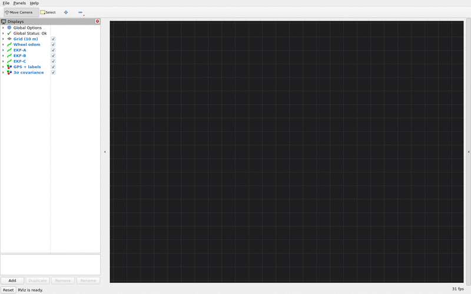
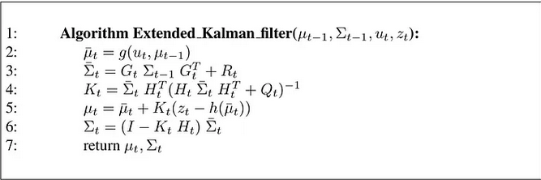
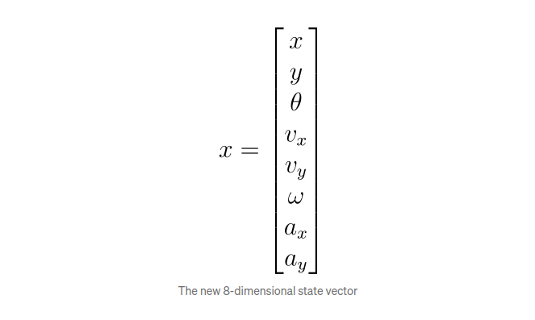
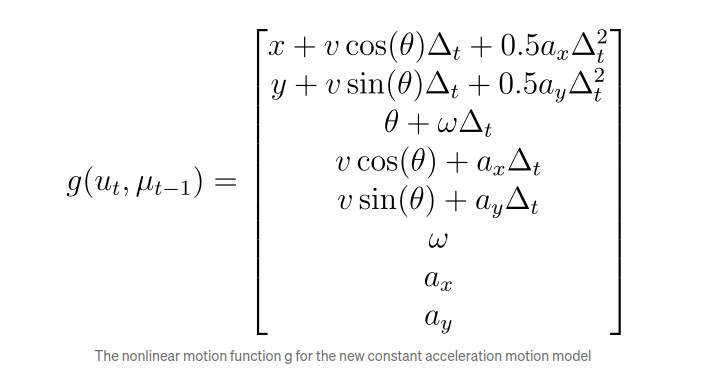
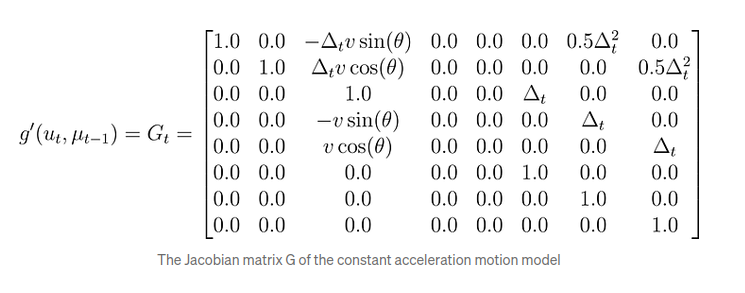
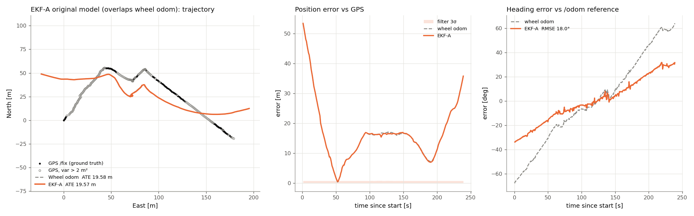
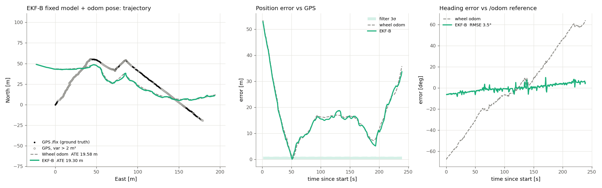
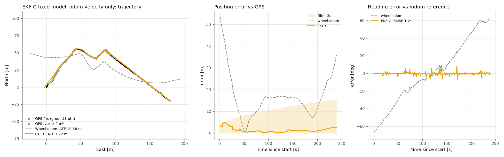

# Extended Kalman Filter (EKF)

An implementation of an **Extended Kalman Filter** for fusing odometry and imu readings when the system follows a **constant‐acceleration** motion model. This repository demonstrates how to design and implement the EKF step by step, from the state definition to the prediction and update equations. 

## Demo: three EKF variants in RViz2



The Linkou bag replayed at 4× speed, with all three EKF variants running side by side and aligned to GPS (white dots).
- **EKF-C** (yellow, wheel velocity + IMU) stays on the GPS track. Its 3σ covariance ellipses grow because position is dead-reckoned, and they always contain the GPS track.
- **EKF-A** (orange) and **EKF-B** (green) drift away together with the raw wheel odometry (gray). Their 3σ ellipses stay under 1 m, too small to see here, even though they are ~20 m off.

See [Evaluation](#evaluation-three-ekf-variants-on-a-real-drive) for the numbers, and `eval/rviz_variants.sh` to run it yourself.

---

## Table of Contents

1. [Overview](#overview)  
2. [State Definition](#state-definition)  
3. [Process (Motion) Model](#process-motion-model)  
4. [Control Input](#control-input)  
5. [Prediction Step](#prediction-step)  
6. [Update Step](#update-step)  
7. [Installation and Usage](#installation-and-usage)  
8. [License](#license)  
9. [References](#references)  

---

## Overview

The Extended Kalman Filter (EKF) is a variant of the Kalman Filter used for **nonlinear** systems. It linearizes the nonlinear process and/or measurement functions about the current estimate using **Jacobian** matrices. The steps are:

1. **Predict** the state based on the motion model and control input (if any).  
2. **Update** the state with incoming sensor measurements.

We apply the EKF in an **8‐dimensional** state space to track:
- Position (`x`, `y`)
- Orientation (`theta`)
- Velocity (`v_x`, `v_y`)
- Angular velocity (`omega`)
- Acceleration (`a_x`, `a_y`)

## Features

- Implements **nonlinear motion models** such as constant acceleration.
- Supports **sensor observation models**, including IMU and odometry fusion.
- Modular **EKF framework** with customizable process and observation models.
- **ROS2-compatible** for real-time robotic state estimation.
- **Configurable process noise and sensor noise covariance matrices.**


```
src/
│── motion_model/                   # Motion model implementations
│   ├── include/motion_model/       # Motion model headers
│   ├── src/                        # Source files for motion models
│   ├── CMakeLists.txt              # CMake configuration for motion models
│   ├── package.xml                 # ROS2 package definition
│
│── observation_model/               # Observation model implementations
│   ├── include/observation_model/  # Observation model headers
│   ├── src/                        # Source files for observation models
│   ├── CMakeLists.txt              # CMake configuration for observation models
│   ├── package.xml                 # ROS2 package definition
│
│── kalman_filter_core/              # EKF implementation
│   ├── include/kalman_filter_core/ # EKF headers
│   ├── src/                        # Source files for EKF
│   ├── CMakeLists.txt              # CMake configuration for EKF
│   ├── package.xml                 # ROS2 package definition
│
│── kalman_filter_app/               # Main application
│   ├── src/                        # Main application source files
│   ├── CMakeLists.txt              # CMake configuration for application
│   ├── package.xml                 # ROS2 package definition
│
│── common_utils/                    # Utility functions (e.g., coordinate conversion)
│   ├── include/common_utils/       # Utility headers
│   ├── src/                        # Source files for utilities
│   ├── CMakeLists.txt              # CMake configuration for utilities
│
```

---





## State Definition

We define the system state as the vector:


where:

- \(x, y\) : Position in the plane  
- \(\theta\) : Orientation (heading angle)  
- \(v_x, v_y\) : Linear velocities in the \(x\) and \(y\) directions  
- \(\omega\) : Angular velocity (turn rate)  
- \(a_x, a_y\) : Linear accelerations in the \(x\) and \(y\) directions  

The state covariance is an \(8 \times 8\) matrix \(\Sigma\).  

---

## Process (Motion) Model

We assume a **constant acceleration** motion model over a time step \(\Delta_t\). The **nonlinear** function \(g\) predicts the next state \(x_{t}\) from \(x_{t-1}\) and control input \(u_t\):



where \(v = \sqrt{v_x^2 + v_y^2}\). 

### Jacobian \(G_t\)
Because \(g\) is nonlinear, the EKF uses the Jacobian:



to linearize the process model at the current state estimate.

---

## Control Input

No Control Input was considered in this application 

---

## Prediction Step

1. **Predict State Mean**  
   \[
   \bar{\mu}_t = g\bigl(u_t,\mu_{t-1}\bigr)
   \]

2. **Predict State Covariance**  
   \[
   \bar{\Sigma}_t = G_t \,\Sigma_{t-1}\,G_t^T + R_t
   \]
   - \(G_t\) is the Jacobian of \(g\) evaluated at \(\mu_{t-1}\).  
   - \(R_t\) is the process noise covariance.

---

## Update Step

Upon receiving a measurement (z_t), the EKF incorporates the sensor reading:

1. **Measurement Prediction**:  
   \[
   \hat{z}_t = h(\bar{\mu}_t)
   \]  
   where \(h\) is the measurement function (could be linear or nonlinear).

2. **Jacobian \(H_t\)**:  
   \[
   H_t = \frac{\partial h}{\partial x}\Big|_{\bar{\mu}_t}
   \]

3. **Kalman Gain**:  
   \[
   K_t = \bar{\Sigma}_t\,H_t^T \Bigl(H_t\,\bar{\Sigma}_t\,H_t^T + Q_t\Bigr)^{-1}
   \]

4. **Update Mean**:  
   \[
   \mu_t = \bar{\mu}_t + K_t\bigl(z_t - \hat{z}_t\bigr)
   \]

5. **Update Covariance**:  
   \[
   \Sigma_t = \bigl(I - K_t\,H_t\bigr)\,\bar{\Sigma}_t
   \]

- (Q_t) is the measurement noise covariance.  
- (z_t) is the actual measurement vector at time (t).


## Installation and Usage


## Dependencies

To use this project, ensure the following dependencies are installed:

- **ROS2 (Humble/Foxy recommended)**
- **Eigen3** for matrix operations
- **C++17 or higher**
- **CMake** (minimum version 3.5)
- **Colcon** (for ROS2 package builds)

## Installation & Build

### **1. Clone the Repository**

```bash

git clone https://github.com/mahajanparth/SensorFusion --recursive
cd SensorFusion

```

### **2. Install Dependencies**

```bash
sudo apt update && sudo apt install -y ros-foxy-eigen3 ros-foxy-colcon
```

### **3. Build the Project**

```bash
colcon build --symlink-install
```

### **4. Source the Workspace**

```bash
source install/setup.bash
```

## Run Procedure

### **1. Launch the Full Sensor Fusion Pipeline**

```bash
# variant:=A|B|C (default C), inputs default to /wheel_odom and /imu/data_raw
ros2 launch kalman_filter_app launch_ekf_node.py variant:=C

ros2 bag play <bag_dir> --topics /wheel_odom /imu/data_raw
```

The fused estimate is published on `/ekf/odom` (`nav_msgs/Odometry`). To reproduce the evaluation below, see [eval/README.md](eval/README.md).

---

## Evaluation: three EKF variants on a real drive

All three variants were run on the Linkou bag linked below: a 240 s, ~247 m outdoor drive with wheel odometry (`/wheel_odom`) and an IMU (`/imu/data_raw`).
- **Ground truth:** GPS `/fix`. It's a standard fix, not RTK, with σ ≈ 0.3–5 m, so errors below ~1.5 m are within GPS noise.
- **Alignment:** every trajectory is aligned to GPS with an SE(2) Umeyama fit (rotation + translation, no scale).
- **Heading:** heading error is measured against the bag's `/odom` reference.

All variants share the same EKF core, the same 8-D state `[x, y, θ, vx, vy, ω, ax, ay]` and the same bug fixes. They differ only in the motion model and in what they fuse:

| | EKF-A | EKF-B | EKF-C |
|---|---|---|---|
| Motion model | original: speed √(vx²+vy²) along θ | world-frame constant acceleration | world-frame constant acceleration |
| Jacobian evaluated at | predicted mean | previous posterior | previous posterior |
| Measurement z | odom x, y, θ · IMU θ, ω, ax, ay (7) | odom x, y, θ · IMU θ, ω · odom v_fwd, v_lat · IMU ax, ay (9) | IMU θ, ω · odom v_fwd, v_lat · IMU ax, ay (6) |
| Odom pose fused | yes | yes | **no** |
| IMU accel | raw, includes gravity tilt | gravity removed, compared in body frame | gravity removed, compared in body frame |
| Measurement noise R | 0.05 everywhere | per sensor | per sensor |

### Results

| Method | ATE vs GPS (full run) | Heading RMSE | RPE @ 10 m |
|---|---:|---:|---:|
| Raw wheel odometry | 19.58 m | 36.1° | 0.60 m |
| EKF-A | 19.57 m | 18.0° | 4.49 m |
| EKF-B | 19.30 m | 3.5° | 10.19 m |
| **EKF-C** | **1.72 m** | **1.2°** | **0.27 m** |

Per-segment numbers (4 × 60 s windows) are in [eval/results/metrics.md](eval/results/metrics.md). EKF-C has the lowest ATE and RPE in every segment.


The key fact about this dataset: **the wheel odometry heading drifts by ~130° over the run**. Its yaw rate reads ~20 % high and is biased. The IMU heading stays within ~2° of the reference. Each variant's result is determined by how it handles this conflict.

### EKF-A: original model



**What's good about the model:** it is the simplest complete IMU + odometry EKF. Every sensor goes into one measurement vector, and the observation model is linear (H is a selection matrix), so it's easy to understand and debug. The constant-acceleration motion model captures smooth speed changes, which a constant-velocity model can't.

**What the plots show:** EKF-A lies almost exactly on top of the wheel odometry (ATE 19.57 m against 19.58 m).
- It trusts the odometry x, y as much as every other sensor (R = 0.05), so its position follows the drifting wheel path.
- Its heading is a compromise between the wheel and IMU headings. It halves the wheel heading error (18° against 36°) but doesn't remove it.
- The raw accelerometer, with gravity leaking in through tilt, is compared directly against world-frame accelerations. This adds jitter, which shows up as the higher RPE.
- Its 3σ band is under 1 m while its real error is ~20 m, so the filter is over-confident.

### EKF-B: fixed model, still fusing the odom pose



**What's good about the model:**
- The world-frame constant-acceleration model keeps the sign of the velocity, so it can represent reversing, and its Jacobian is exact.
- The Jacobian is evaluated at the previous estimate, as in the textbook EKF.
- Gravity is removed from the IMU using its orientation, and accelerations and wheel velocities are compared in the body frame, where those sensors actually measure.
- The odom pose is expressed relative to the starting pose, so it shares a reference with the IMU yaw. This replaces the hardcoded −90° rotation.

**What the plots show:**
- **Heading is fixed.** The heading error drops to 3.5° RMSE and no longer drifts (right panel).
- **Position isn't.** It is still fused as an absolute measurement, but the odom x, y were integrated with the bad wheel heading, so they aren't independent information. They keep pulling the estimate back onto the wheel path (left and middle panels, ATE 19.30 m).
- **The two disagree.** The correct heading and the wrong position fight each other, which produces jumps (RPE 10 m) and a 3σ band that's again far too small.

### EKF-C: fixed model, wheel velocity + IMU only (recommended, launch default)



**What's good about the model:** it uses the same improved model as B but fuses only what each sensor measures well:
- from the wheels: **speed** (v_fwd, plus v_lat ≈ 0 for a non-holonomic robot)
- from the IMU: **heading, yaw rate and gravity-compensated acceleration**

Position is never measured directly. It comes from the motion model integrating speed along the IMU-corrected heading. This is the standard way to fuse wheel odometry: as a velocity sensor, not a pose sensor.

**What the plots show:**
- **Position:** the trajectory stays on the GPS track for the whole drive (ATE 1.72 m against 19.58 m for wheel odometry). Most of the remaining error is in the first ~30 s, where the GPS itself is poorest (open circles).
- **Heading:** the error is flat around 0° (1.2° RMSE).
- **Consistency:** the 3σ band grows steadily because position is dead-reckoned, and it always contains the actual error, so the filter's covariance can be trusted.


---

#Future Scope of the Project :

1) ADD UKF in the kalman core module 
2) compare with constant velocity model 
3) modify the package to take in multiple instances of sensor module 

---
Download ROSBAG LINK : https://www.dropbox.com/scl/fi/tdxin6bzw01siucdv3kgv/linkou-2023-12-27-2-med.zip?rlkey=rcz93bhozjsdymcpn5dqz6rly&e=1&dl=0

---

## Contributors

- **Parth Mahajan** (Author)

## License

This project is licensed under the **MIT License**.


