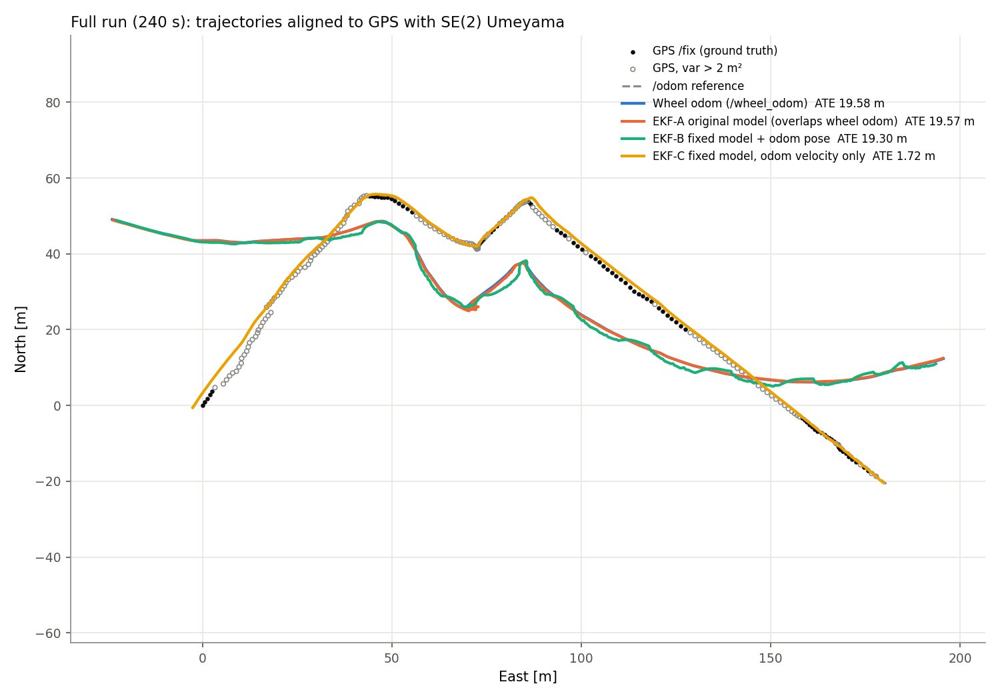
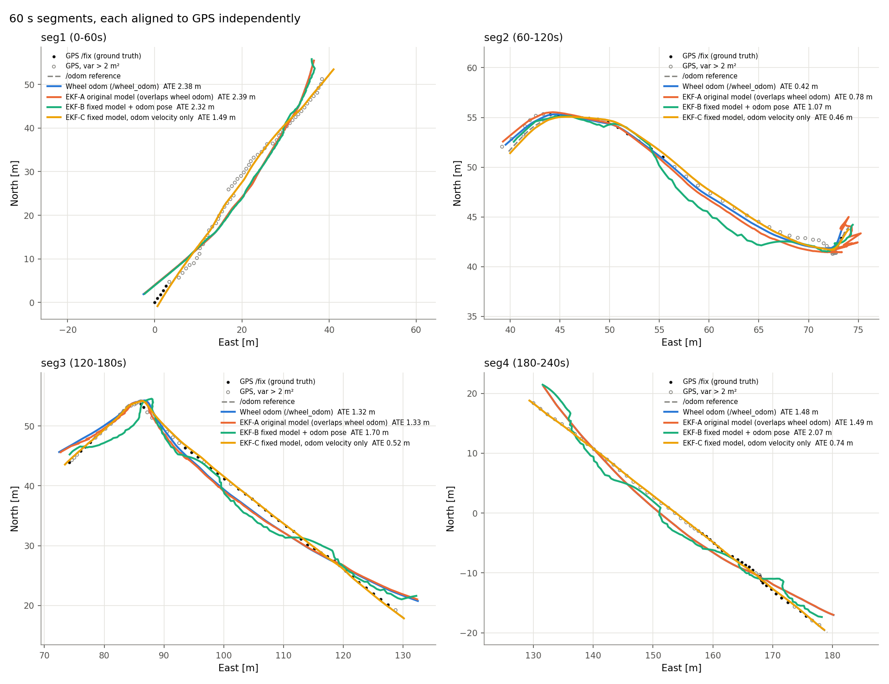
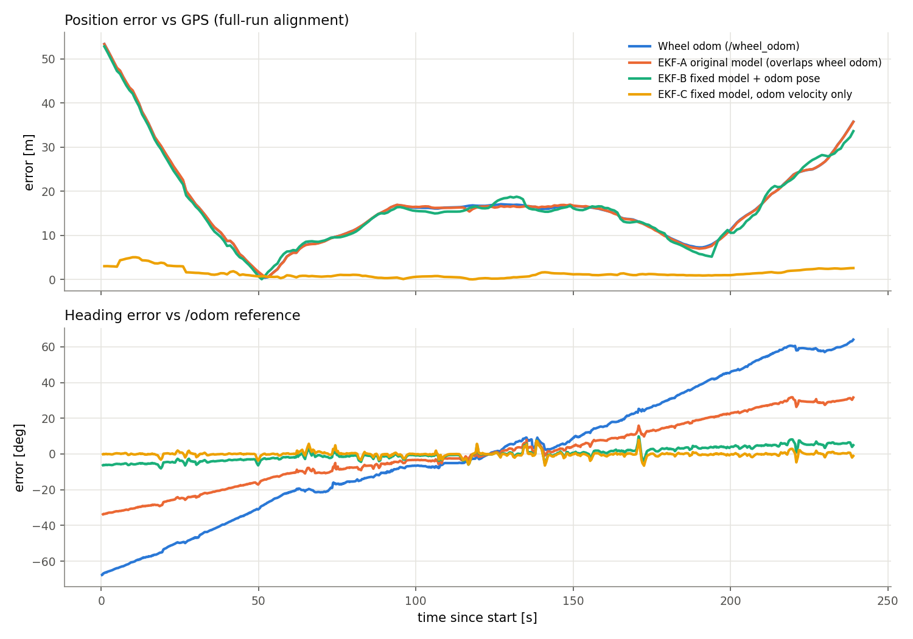
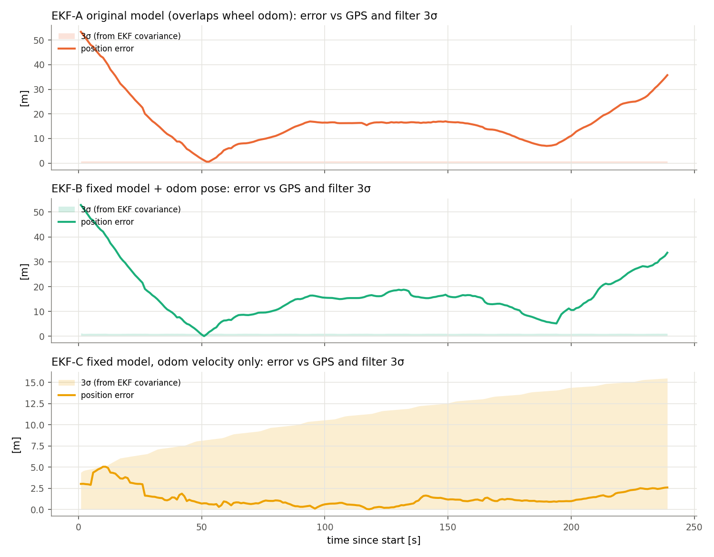

# EKF evaluation on the Linkou dataset

The IMU + wheel-odometry EKF was run on a real 240 s outdoor drive (`linkou-2023-12-27-2-med`, about 247 m). Its output was scored against GPS.

## Result

| method | full run ATE vs GPS | heading RMSE | RPE @ 10 m |
|---|---:|---:|---:|
| raw `/wheel_odom` | 19.58 m | 36.1° | 0.60 m |
| **EKF-A**: original model, minimal bug fixes | 19.57 m | 18.0° | 4.49 m |
| **EKF-B**: fixed model, odom *pose* + twist + IMU | 19.30 m | 3.5° | 10.19 m |
| **EKF-C**: fixed model, odom *twist* + IMU | **1.72 m** | **1.2°** | **0.27 m** |

Per-segment numbers (4 x 60 s, each re-aligned) are in [results/metrics.md](results/metrics.md). In every segment C has the lowest ATE and RPE. Its heading RMSE is also the lowest or close to it (0.6-1.8°), except in segments 2-3, where B's heading is 0.3-0.5° better.






### Interpretation
- **The wheel odometry heading drifts about 130° over the run.** Its yaw rate reads about 20 % high and has a bias. The IMU yaw matches the reference to within about 2°, so all of the useful correction comes from the IMU heading.
- **A tracks wheel odometry almost exactly.** A treats the wheel odom pose as an absolute measurement with R = 0.05 and sets IMU accel noise equal to it. The position therefore follows the drifting odom pose. Heading is a compromise between the two sources, and the jitter shows up as the large RPE.
- **B gets the heading right but not the position.** The odom pose (position plus the drifting odom yaw) is still treated as an absolute measurement, so it pulls the position back onto the wheel trajectory. The fused heading and the odom position disagree, which produces jumps (RPE 10 m). Feeding an integrated odometry pose as an independent measurement is the core design error.
- **C fuses the right quantities:** body-frame wheel velocity, IMU yaw rate and yaw, and gravity-compensated IMU acceleration. Position is dead-reckoned from velocity x IMU heading. The error peaks at 5.1 m in the first 15 s, then stays below 2.6 m for the rest of the run. The filter's own 3σ bound contains it (plot 4). A and B claim 3σ < 1 m while being 20+ m off, so they are inconsistent.
- About 1.7 m is close to the GPS floor. 64 % of `/fix` samples have a horizontal variance > 2 m² (open circles). Most of C's remaining error is in the first 30 s, where the GPS is poorest.

## Ground truth and its limitations
- **`/navrelposned` (RTK) is not usable as position ground truth.** The receiver runs in moving-base mode: RELPOSNED is the antenna-to-antenna baseline (0-5 m) and is valid in only 94/240 messages. `/navheading` reports a covariance of 1000+ rad² throughout. Position ground truth is therefore **`/fix` GPS** (1 Hz, standard fix, σ ≈ 0.3-5 m), converted to a local ENU frame.
- **`/odom`** (4.6 Hz) is used as a dense secondary reference, for heading and for "ATE vs /odom ref". It agrees with GPS to 1.6 m. However, it matches EKF-C to 0.26 m, which suggests it is itself a wheel + IMU fusion. Treat it as a reference, **not independent ground truth**. The GPS columns are the independent metric.
- Every trajectory is aligned to the ground truth with an SE(2) Umeyama fit (rotation + translation, no scale) before ATE is computed. Heading error is computed after removing each method's constant yaw offset.

## What was changed in the code
Fixes required to get any output (all variants):
- `Q_process_noise`/`R_observation_state` were `VectorXd` but held matrices. They are now `MatrixXd` through the node, `SensorFusionImuOdom` and the `EKF` constructor.
- Init flags were uninitialized. `ay` read `linear_acceleration.x`.
- The node never published anything. It now publishes `/ekf/odom` (pose, x/y/yaw covariance, twist).
- `dt` is now computed from odom header stamps instead of a hardcoded 0.1. The data actually arrives in bursts, with dt between 0 and 0.8 s.
- Angle innovations are wrapped to [−π, π] (`EKF::setAngleIndices`).
- `common_utils` used `nav_msgs`/`tf2` without declaring them. Builds failed on anything but Foxy's merged include directory. Packages using structured bindings now build as C++17.

Model fixes (`model_fixes:=true`, variants B/C):
- `EKF::predict` linearizes at the previous posterior, not the predicted mean.
- `ConstantAccWorldMotionModel`: world-frame constant acceleration. Velocity keeps its sign, whereas `sqrt(vx²+vy²)` could not represent reversing.
- `ImuOdomBodyFrameObservationModel`: compares the wheel twist (v_fwd, v_lat) and IMU accel with the state rotated into the body frame. Gravity is removed using the IMU orientation. The odom pose measurement is optional (`use_odom_pose`).
- Odom pose is expressed in the initial body frame. This replaces the hardcoded −90° rotation, so it shares a reference with the relative IMU yaw.

Variant A keeps the original model, the linearization point and the −90° rotation, so it reflects the original design.

## Reproducing
The host ROS Foxy install is incomplete (no `ros2` CLI or `rclpy`, and `rcl_logging_spdlog` links against the wrong fmt). The node is therefore built and run in the `ros:humble-ros-base-jammy` container:

```bash
# bag unzipped to ~/Downloads/linkou/
docker run --rm -v "$PWD":/ws -v ~/Downloads/linkou:/data:ro ros:humble-ros-base-jammy \
    bash /ws/eval/run_variants.sh A B C          # → eval/results/run_{A,B,C}
python eval/evaluate.py                          # anaconda python: rosbags, numpy, matplotlib
```

`run_variants.sh` plays `/wheel_odom` and `/imu/data_raw` at 4× speed. Results do not depend on the rate because `dt` comes from header stamps. Launch a single variant with `ros2 launch kalman_filter_app launch_ekf_node.py variant:=C`.
